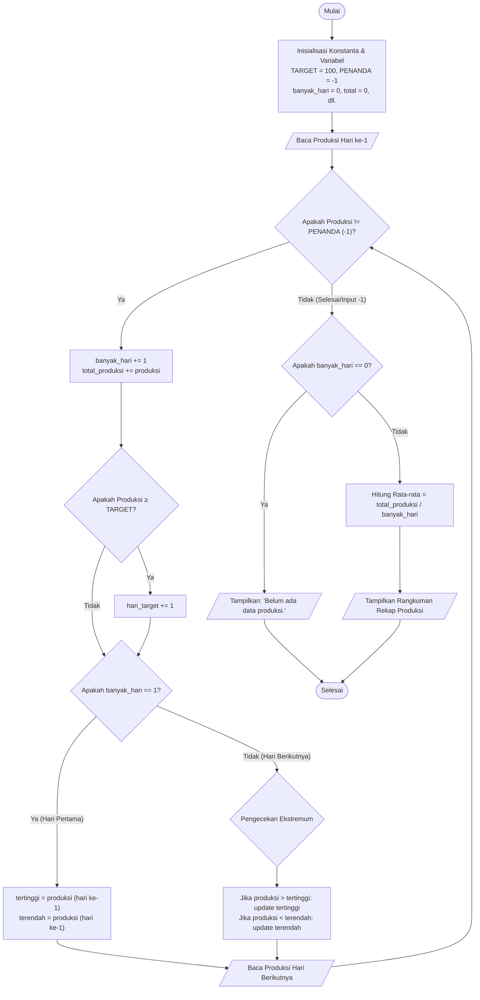

# Laporan Praktikum Modul 3: Perulangan dengan Kondisi Berhenti (Pola Sentinel) & Agregasi Data


---

## 📖 Deskripsi Studi Kasus
Pada praktikum Modul 3 ini, dibuat program Python bertajuk **Rekap Produksi Harian Lini Perakitan**. Program ini ditujukan untuk memantau dan mencatat hasil unit produksi harian sebuah lini perakitan manufaktur dengan periode pengamatan yang dinamis (jumlah hari tidak ditentukan di awal).

Program menerapkan **pola pengulangan berbasis penanda (*sentinel-controlled loop*)**, di mana masukan data produksi akan terus dibaca hari demi hari sampai pengguna memasukkan nilai sentinel `-1`. Program kemudian merangkum performa produksi harian berupa total unit, rata-rata harian, capaian target harian, serta mendeteksi nilai produksi tertinggi dan terendah beserta hari terjadinya.

---

## 🎯 Aturan & Ketentuan Program

Berdasarkan spesifikasi studi kasus, berikut adalah aturan yang diterapkan pada sistem:

| Bagian | Ketentuan Program | Implementasi Kode |
| :--- | :--- | :--- |
| **Masukan** | Data produksi per hari bertipe integer (&ge; 0), dibaca berurutan mulai dari hari ke-1. | `int(input(...))` |
| **Penanda (*Sentinel*)** | Angka `-1` sebagai sinyal akhir data masukan (tidak dihitung sebagai data produksi). | Konstanta `PENANDA = -1` |
| **Target Harian** | Standar minimal 100 unit per hari. | Konstanta `TARGET = 100` |
| **Total & Rata-rata** | Total akumulasi seluruh unit dan rata-rata harian diformat 2 angka di belakang desimal. | `rata_rata:.2f` |
| **Hari Mencapai Target** | Menghitung banyaknya hari dengan produksi &ge; 100 unit. | Counter `hari_target += 1` |
| **Tertinggi & Terendah** | Mencatat unit tertinggi & terendah beserta nomor harinya. Jika ada nilai yang sama, pilih hari paling awal. | Operator pembanding `>` dan `<` |
| **Penanganan Tanpa Data** | Jika pengguna langsung mengetik `-1` pada hari pertama, program menampilkan pesan khusus tanpa galat (*zero division error*). | `if banyak_hari == 0:` |

---

## 🔄 Alur Program (Flowchart)



---

## 💻 Implementasi Kode (`studi_kasus.py`)

Berikut adalah kode program lengkap yang diimplementasikan pada file [`studi_kasus.py`](studi_kasus.py):

```python
# Konstanta
TARGET = 100
PENANDA = -1

# Inisialisasi variabel awal
banyak_hari = 0
total_produksi = 0
hari_target = 0
tertinggi = 0
hari_tertinggi = 0
terendah = None  # Tidak diisi 0 agar tidak mengganggu pencarian nilai minimum
hari_terendah = 0

# Baca produksi hari ke-1 sebelum perulangan (Pola Sentinel / Penanda)
produksi = int(input(f"Produksi hari ke-{banyak_hari + 1} ({PENANDA} untuk selesai): "))

while produksi != PENANDA:
    banyak_hari += 1
    total_produksi += produksi

    # Hitung hari mencapai target
    if produksi >= TARGET:
        hari_target += 1

    # Memperbarui nilai tertinggi dan terendah dan harinya
    if banyak_hari == 1:
        tertinggi = produksi
        hari_tertinggi = banyak_hari
        terendah = produksi
        hari_terendah = banyak_hari
    else:
        if produksi > tertinggi:
            tertinggi = produksi
            hari_tertinggi = banyak_hari
        if produksi < terendah:
            terendah = produksi
            hari_terendah = banyak_hari

    # Baca produksi hari berikutnya di akhir blok while
    produksi = int(input(f"Produksi hari ke-{banyak_hari + 1} ({PENANDA} untuk selesai): "))

# Output Rekap Produksi
print("=== REKAP PRODUKSI ===")
if banyak_hari == 0:
    print("Belum ada data produksi.")
else:
    rata_rata = total_produksi / banyak_hari
    print(f"Banyak hari : {banyak_hari}")
    print(f"Total produksi : {total_produksi}")
    print(f"Rata-rata per hari: {rata_rata:.2f}")
    print(f"Hari mencapai target ({TARGET}): {hari_target}")
    print(f"Tertinggi: {tertinggi} unit (hari ke-{hari_tertinggi})")
    print(f"Terendah : {terendah} unit (hari ke-{hari_terendah})")
```

### 🔍 Penjelasan Komponen Kode:
1. **Konstanta Global**:
   - `TARGET = 100` dan `PENANDA = -1` dideklarasikan dengan huruf kapital untuk mencerminkan nilai konstan yang tidak berubah selama eksekusi program.
2. **Penetapan Nilai Awal Variabel Ekstremum**:
   - Variabel `terendah` diinisialisasi dengan `None` (bukan `0`), sehingga nilai produksi riil tidak akan kalah kecil dibanding angka nol saat inisialisasi.
3. **Pola Pembacaan Berulang (*Priming Read & Loop*)**:
   - Input pertama diminta sebelum blok `while` (*priming read*).
   - Di dalam blok `while`, pembacaan hari berikutnya dilakukan di baris paling bawah. Hal ini menjamin nilai `-1` tidak akan ikut terhitung ke dalam total atau banyak hari.
4. **Pembaruan Nilai Tertinggi & Terendah**:
   - Pada hari ke-1 (`banyak_hari == 1`), nilai masukan langsung menjadi baseline tertinggi dan terendah.
   - Pada hari selanjutnya, nilai dibandingkan secara terpisah menggunakan operator `>` dan `<` ketat (bukan `>=` atau `<=`), memastikan jika ada nilai kembar, hari yang paling awal yang tetap dipertahankan sesuai spesifikasi.
5. **Format Desimal & Pencegahan Galat**:
   - Syntax `{rata_rata:.2f}` membatasi angka desimal rata-rata presisi 2 angka di belakang koma.
   - Pengecekan `if banyak_hari == 0` mencegah program mengalami error fatal pembagian dengan nol (*ZeroDivisionError*).

---

## 🧪 Hasil Uji Coba (Testing)

### Kasus 1: Pengujian Normal (Beberapa Hari Produksi)
- **Input Data:**
  - Hari ke-1: `95`
  - Hari ke-2: `120`
  - Hari ke-3: `100`
  - Hari ke-4: `80`
  - Hari ke-5: `-1` *(Penanda Selesai)*
- **Output Terminal:**
  ```text
  Produksi hari ke-1 (-1 untuk selesai): 95
  Produksi hari ke-2 (-1 untuk selesai): 120
  Produksi hari ke-3 (-1 untuk selesai): 100
  Produksi hari ke-4 (-1 untuk selesai): 80
  Produksi hari ke-5 (-1 untuk selesai): -1
  === REKAP PRODUKSI ===
  Banyak hari : 4
  Total produksi : 395
  Rata-rata per hari: 98.75
  Hari mencapai target (100): 2
  Tertinggi: 120 unit (hari ke-2)
  Terendah : 80 unit (hari ke-4)
  ```

---

### Kasus 2: Pengujian Tanpa Data (Sentinel di Hari Pertama)
- **Input Data:**
  - Hari ke-1: `-1` *(Langsung Selesai)*
- **Output Terminal:**
  ```text
  Produksi hari ke-1 (-1 untuk selesai): -1
  === REKAP PRODUKSI ===
  Belum ada data produksi.
  ```

---

## 🚀 Cara Menjalankan Program

1. Buka terminal dan arahkan ke direktori modul 3:
   ```bash
   cd modul3
   ```

2. Jalankan script program:
   ```bash
   python3 studi_kasus.py
   ```

3. Masukkan data unit produksi per hari. Ketik `-1` jika seluruh data telah selesai diinput.

---

## 📌 Kesimpulan
Berdasarkan praktikum Modul 3 ini:
- Pola perulangan sentinel (*sentinel-controlled loop*) menggunakan `while` efektif untuk membaca masukan berulang yang durasi atau jumlah datanya tidak diketahui di awal.
- Penanganan nilai awal untuk variabel ekstremum (tertinggi dan terendah) berhasil diatasi dengan memanfaatkan inisialisasi pada hari pertama (`banyak_hari == 1`).
- Penggunaan operator perbandingan ketat (`>` dan `<`) berhasil mempertahankan hari pertama terjadinya rekor saat terdapat nilai ekstrem kembar.
- Validasi data kosong (`banyak_hari == 0`) sukses menangani kondisi *edge case* tanpa memicu *ZeroDivisionError*.
